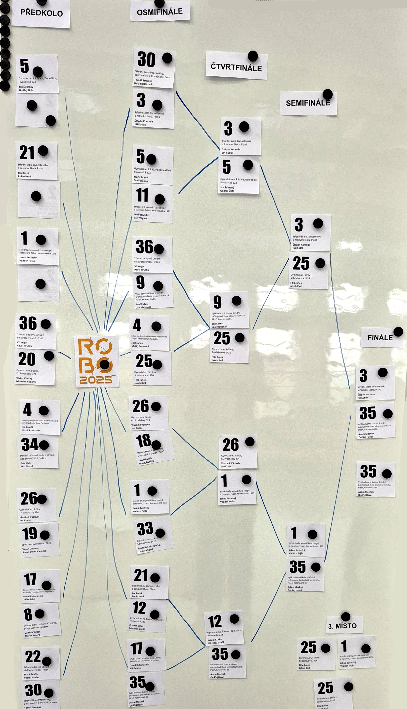
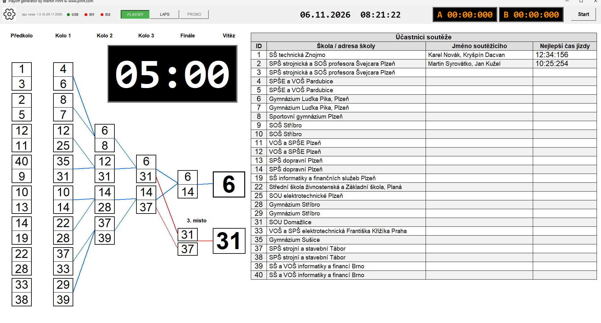
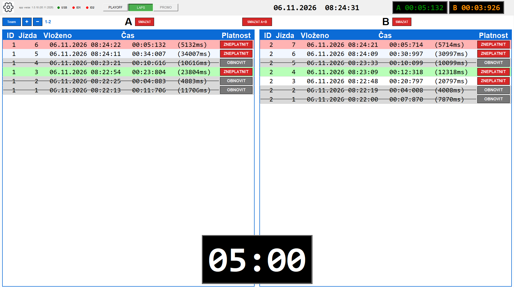
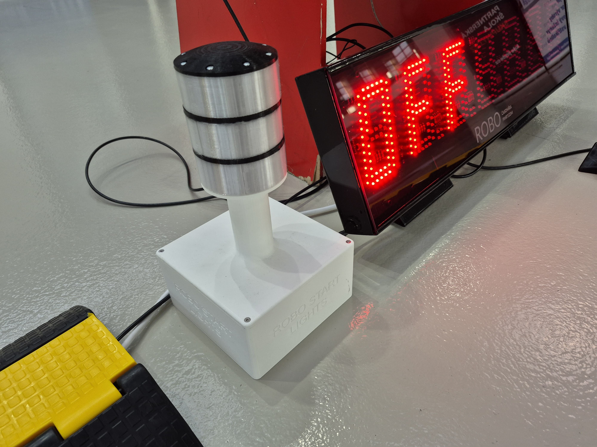
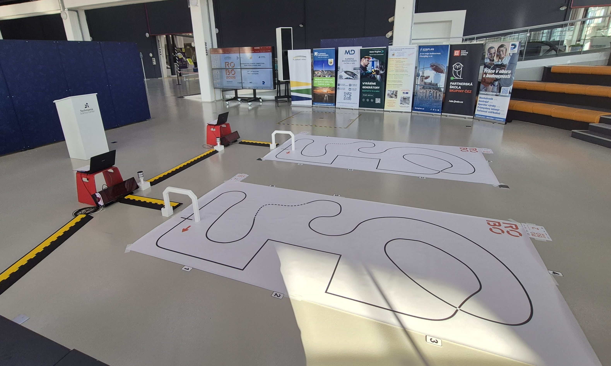
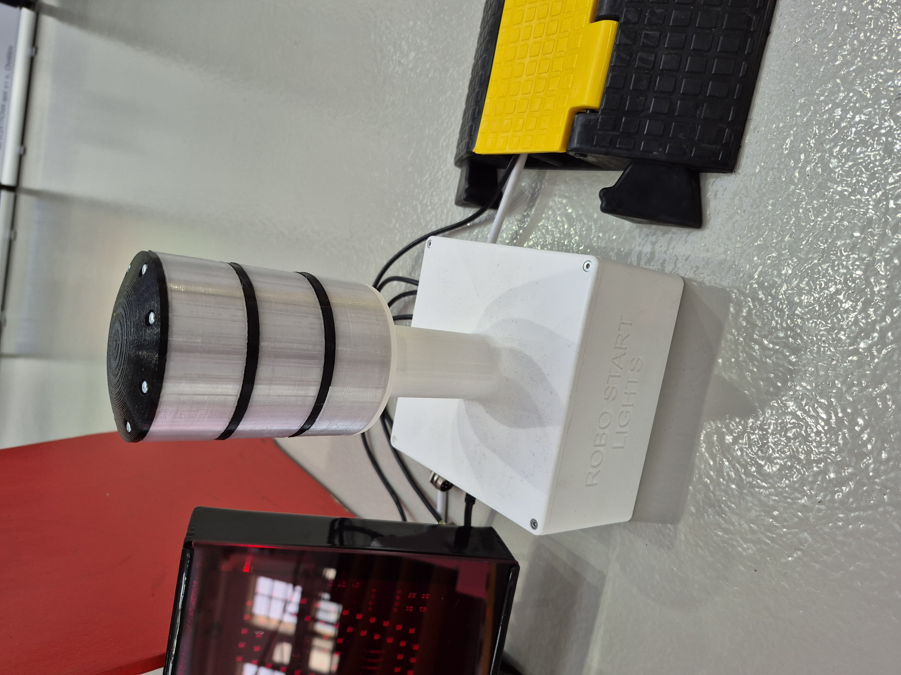
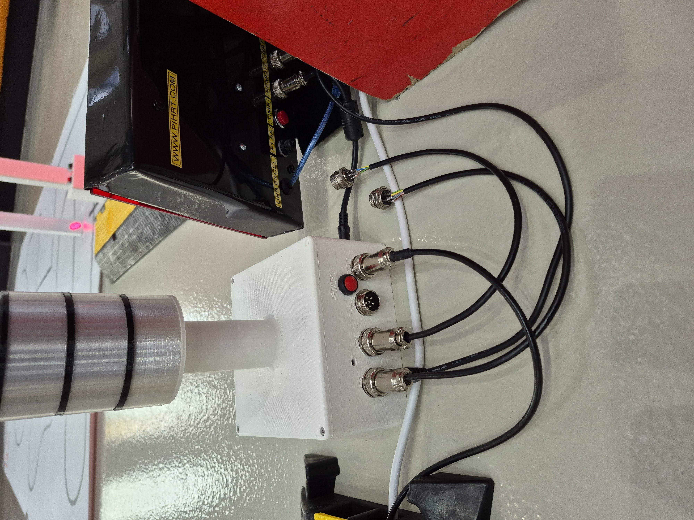

# Playoff

[](https://github.com/pihrt-com/playoff/releases/latest)
[](https://github.com/pihrt-com/playoff/releases)
[](https://github.com/pihrt-com/playoff/actions/workflows/tests.yml?query=branch%3Amain)
[](https://github.com/pihrt-com/playoff/blob/main/LICENSE)

Zde naleznete aplikaci pro MS Windows (instalace i portable verze), dokumentaci hardware (zapojení, 3D modely, STL soubory) a firmware pro Arduino.

V aplikaci lze generovat pavouka až pro 28 týmů. Levým tlačítkem zadáváme číslo nebo název týmu, pravým tlačítkem postupujeme tým do dalšího kola. Výsledný pavouk lze uložit, načíst, exportovat do PDF a propojit se startovními semafory. Nebo se lze přepnout do řežimu měření časů jednotlivých kol. Pokud je kolo kratší než 10 vteřin je podbarvené pole červené. Nejkratší čas v kolech je podbarven zeleně.

## Aktuální změny – 09. 11. 2026

Režim LAPS zobrazuje mezi označením drah A/B a záhlavím výsledků školu a jméno soutěžícího pro právě vybranou dvojici. Údaje se načítají z Pojmenování týmů pouze při přesné shodě ID; pokud seznam nebo odpovídající ID neexistuje, informační řádky zůstanou prázdné.

Sloupec Nejlepší čas jízdy se odvozuje od nejrychlejšího platného zeleného výsledku LAPS pro stejné ID. V aplikaci a v PDF se zobrazuje například `00:12:500 (12500)`, ale do Excelu se exportuje pouze hodnota `12500` v milisekundách; formátovaný text se do projektu ani do pojmenování týmů neukládá. Každá stránka PDF exportu LAPS uvádí pod nadpisem také odpovídající školu, soutěžícího a nejlepší platný čas.

Tabulka účastníků vedle pavouka slučuje ID z předkola i Kola 1, pokud je předkolo zapnuté; stejný tým se zobrazí jen jednou. Obsahuje čtyři upravitelné sloupce pro ID, školu nebo adresu, jméno soutěžícího a nejlepší čas jízdy. Kliknutím lze změnit společný nadpis i každé záhlaví sloupce a nastavení se ukládá do souboru projektu.

Dialog Pojmenování týmů podporuje import i export Excelu se čtyřmi sloupci a přijímá také starší nebo částečně vyplněné tabulky. Všechna dialogová okna Playoffu včetně nastavení odpočtu používají ikonu programu místo výchozí ikony Tkinteru. Škola a jméno soutěžícího se v tabulce vykreslují menším písmem, které se podle dostupné šířky ještě zmenší, aniž by se zvětšila výška řádku.

Režim LAPS nově rozlišuje ID týmu a pořadí jízdy. Modrá tlačítka `Team`, `+` a `−` přepínají dvojice týmů, přičemž výrazný údaj vedle tlačítek stále ukazuje aktuální dvojici, například `1-2` nebo `3-4`. Každá dvojice si uchovává vlastní výsledky a po návratu je znovu zobrazí. Maximální sudý počet týmů, výchozí hodnotu 40 a úplné vymazání historie všech týmů obsahuje nové podmenu `LAPS`; celý stav se ukládá do projektu.

Každý záznam dráhy A nebo B lze označit tlačítkem `ZNEPLATNIT`. Záznam zůstane zachovaný pod stejným ID týmu a číslem jízdy, graficky se přeškrtne a neúčastní se výběru zeleně zvýrazněného nejrychlejšího kola. Tlačítko `OBNOVIT` jej vrátí mezi platné záznamy. Nadpis `Platnost` používá stejný font a velikost jako ostatní záhlaví tabulky.

Samostatné okno updateru používá stejnou ikonu Playoffu jako hlavní aplikace a její dialogy.

## Aplikace

Magnetická tabule (takto to nemá vypadat)

[](https://github.com/pihrt-com/playoff/blob/main/Example/table.jpg)

App (takto vypadá okno aplikace)

[](https://github.com/pihrt-com/playoff/blob/main/Example/ex1.png)

[](https://github.com/pihrt-com/playoff/blob/main/Example/ex9.png)

## Opakovaný odpočet v režimu LAPS

Volba „Povolit odpočet“ zobrazuje časovač také v režimu LAPS, kde je umístěný dole uprostřed nad poli A a B. Pravým tlačítkem se nastavuje společný interval `MM:SS`; levým tlačítkem se odpočet spustí od maxima nebo se na maximum kdykoliv vrátí a znovu spustí.

Po dosažení nuly se nastavený interval automaticky obnoví a začne další cyklus. Během posledních 10 sekund se pozadí střídá mezi černou a červenou, zatímco text zůstává bílý. Vypnutí volby nebo přepnutí z režimu LAPS cyklus zastaví. Jednorázové spouštění odpočtu v režimu PLAYOFF přes START/OK zůstává beze změny.

V horní liště LAPS jsou samostatná tlačítka `SMAZAT` pro A a B a mezi nimi červené tlačítko `SMAZAT A+B`. Společná akce po potvrzení smaže záznamy obou drah právě zobrazené dvojice a obnoví jejich číslování jízd od jedničky. Úplné vymazání výsledků všech dvojic je dostupné v podmenu `Nastavení → LAPS` a provede je také hlavní akce `Vymazat všechno`.

Původní položka exportu se jmenuje `Export do PDF PLAYOFF`. Nová položka `Export do PDF LAPS` uloží jednu stránku pro každý nastavený tým se všemi jeho jízdami. Tabulka používá stejné sloupce a barevné rozlišení jako aplikace, ale neobsahuje ovládací tlačítka.

## Průběžný čas na LED displejích

V nabídce Nastavení lze volbou „Měřit a zobrazit čas kola“ zapnout měření drah A a B. Zatržítko „Odesílat na LED průběžný čas“ navíc zapne pravidelné odesílání běžícího času na příslušný LED displej.

Položka „Rychlost obnovování“ nabízí intervaly od 0,1 s do 1,0 s. Každý displej se aktualizuje jen po dobu běhu své dráhy; po dojezdu se okamžitě odešle přesný konečný čas a druhá dráha může pokračovat. Průběžné odesílání je ve výchozím nastavení vypnuté.

Nastavení se ukládá do uživatelského souboru `.playoff_settings.json` i do uloženého projektu `.setup`.

## Propagační text na LED displejích

Položka „Nastavit propagační text“ v nabídce Nastavení uloží text o délce nejvýše 79 základních znaků bez diakritiky. Tlačítko `PROMO` v horní liště odešle text na všechny nastavené LED displeje, pokud právě neběží závod, odpočet ani měření času.

K dispozici je plynulá rotace řízená aplikací, která funguje i s firmwarem displeje 1.0, nativní rolování panelu příkazem `SCR` a statický text příkazem `TXT`. Posuvník nastavuje rychlost od 1 do 20 znaků za sekundu; text, režim i rychlost se ukládají do uživatelského JSON i do souboru projektu. START nebo potvrzená změna režimu PLAYOFF/LAPS propagační text smaže a vrátí běžné chování displejů.

## Inicializace USB zařízení

Brána a oba LED displeje se připojují nezávisle. Pro každé zařízení lze zvolit „Nepoužívat“, takže je možné provozovat nebo testovat samotný LED displej bez připojené brány. Aplikace odmítne přiřazení stejného COM portu více zařízením a zobrazí srozumitelnou chybu.

Pravá část dialogu USB nastavení zobrazuje nalezenou bránu a LED displeje podle uloženého přiřazení a dostupných informací zařízení. Dočasně nedostupný nebo právě se probouzející displej neblokuje druhý displej a při dalším odeslání se zkusí znovu. Potvrzení změny nastavení zachová nezměněné spojení displeje a bránu podle potřeby odpojí nebo znovu připojí, takže není nutné odpojovat USB ani restartovat aplikaci.

## Aktualizace programu

Po potvrzení nové verze se otevře samostatné okno „Aktualizace Playoff“. Zobrazuje připojení k serveru, průběh a velikost stahovaného instalačního souboru, jeho ověření a spuštění instalátoru.

Okno updateru používá ikonu `playoff.ico` stejně jako hlavní aplikace a ostatní dialogy.

Instalátor se před spuštěním kontroluje podle velikosti a SHA-256 uvedeného v aktualizačním manifestu. Při chybě zůstane okno otevřené se srozumitelnou zprávou a technickými podrobnostmi; uživatel může stahování zopakovat, zavřít updater nebo znovu spustit původní Playoff.

Aplikace nabídne instalaci pouze tehdy, když je číslo zveřejněné verze skutečně vyšší než číslo právě spuštěné verze; starší vydání proto nelze omylem nabídnout jako aktualizaci.

---

# Hardware (Arduino MEGA)

Projekt používá dva nezávislé semafory, dvě laserové brány a komunikaci RS485.

## Pinout

### Semafor A

| Pin | Funkce |
|------|---------|
| D9 | Red 1 |
| D10 | Red 2 |
| D11 | Green |
| D12 | Piezo A |
| D22 | Laserová brána A |
| D25 | WS2812B A (16 LED) |

### Semafor B

| Pin | Funkce |
|------|---------|
| D3 | Red 1 |
| D5 | Red 2 |
| D6 | Green |
| D4 | Piezo B |
| D24 | Laserová brána B |
| D23 | WS2812B B (16 LED) |

### Ostatní

| Pin | Funkce |
|------|---------|
| D8 | START tlačítko |
| D2 | RS485 EN |
| D26 | Piezo SUM |
| RX0/TX0 | USB |
| RX1/TX1 | RS485 |

---

# WS2812B LED pásky

Každý semafor používá samostatný pásek 16 LED.

- LED 0–7 = RED1
- LED 8–15 = RED2
- GREEN = všech 16 LED zeleně

Používá se plynulý náběh a doběh (fade in / fade out) stejně jako u klasických LED výstupů.

---

# Komunikace

## PC → Arduino

```text
start
```

## Arduino → PC

```text
ok
finish_a
finish_b
race_finished
```

---

# False Start

Během odpočtu je sledována laserová brána.

Pokud jezdec vyjede předčasně:

- vyhlásí se FALSE START
- spustí se světelná a zvuková signalizace
- návrat vozidla na start se ignoruje

Vyhodnocení cíle:

### Bez false startu

1. průjezd = odjezd ze startu
2. průjezd = cíl

### Po false startu

1. průjezd = false start
2. průjezd = návrat na start
3. průjezd = cíl

---

# Firmware Brána (semafor mega)

### FW 1.0
- jeden semafor

### FW 1.1
- dva semafory
- dvě laserové brány

### FW 1.2
- odesílání průjezdů do aplikace

### FW 1.3
- RGB WS2812B pásky
- opravy false start logiky

### FW 1.4
- dva RGB pásky (16 LED + 16 LED) https://www.laskakit.cz/8x-inteligentni-rgb-led-neopixel-pasek--ws2812b--5050--5v/
- piezo SUM
- ochrana proti držení START tlačítka
- rozšířená false start logika
- stabilnější měření kol
- debounce průjezdu bránou

### FW 1.5
- režim brány (playoff/laps) příkazy: mode_playoff a mode_laps

# Firmware 7 segmentový displej (nano)

### FW 1.0
- 7 segmentový LED displej ovládaný Arduino Nano, připojený segmenty přes posuvné registry 74HC

### FW 1.1
- plynulá kruhová rotace textu bez prázdného restartu
- zachování mezer v propagačním textu
- ovládání rychlosti příkazem `SPD`

---

# 3D tisk

Semafory se skládají z:

- základny s elektronikou
- základny bez elektroniky
- držáků světel
- průhledných světelných prstenců

Modely jsou připraveny pro 3D tisk.

---

# ROBO 2026

Ukázka použití ze soutěže ROBO 2026 – Techmania a SOUE Plzeň

[](https://github.com/pihrt-com/playoff/blob/main/Example/jpg1.png)

[](https://github.com/pihrt-com/playoff/blob/main/Example/jpg2.png)

[](https://github.com/pihrt-com/playoff/blob/main/Example/jpg3.png)

[](https://github.com/pihrt-com/playoff/blob/main/Example/jpg4.png)

---

# Kredity

- Arduino MEGA
- Python
- Tkinter
- Adafruit NeoPixel
- Martin Pihrt (APP, FW)
- David Netušil (HW, 3D)

---

# Printables

https://www.printables.com/model/1658726-playoff-semaphore-for-robocompetition

# PIHRT.COM

https://pihrt.com/elektronika/493-playoff-app-pro-robovehicle

## Historie změn

### 09. 11. 2026 – GitHub/playoff – verze 1.0.19

Verze 1.0.19 propojuje režim LAPS s Pojmenováním týmů podle přesné shody ID. Nad tabulkami A/B zobrazuje školu a soutěžícího, nejlepší platný zelený čas promítá do tabulky účastníků ve formátu `00:12:500 (12500)` a do Excelu zapisuje pouze milisekundy. PDF export LAPS uvádí na každé stránce školu, soutěžícího a nejlepší čas; informační řádky v aplikaci mají odstup od ovladačů a škola používá normální řez písma.

### 05. 11. 2026 – GitHub/playoff – verze 1.0.18

Verze 1.0.18 přidává v režimu LAPS samostatnou historii pro každý tým, přepínání dvojic s viditelným údajem aktuálních ID, oddělené sloupce ID a Jízda, ukládání a načítání všech výsledků v projektu a úplné mazání před novou soutěží. Nový export PDF LAPS vytváří jednu grafickou stránku pro každý tým. Záhlaví tabulky mají sjednocené písmo a updater používá ikonu Playoffu.

### 03. 11. 2026 – GitHub/playoff – verze 1.0.16

Verze 1.0.16 umožňuje vypnout libovolný USB port volbou „Nepoužívat“, testovat LED displeje bez připojené brány, zabrání dvojímu použití stejného COM portu a v rozšířeném dialogu ukazuje nalezená zařízení. Nové tlačítko `PROMO` zobrazuje uložený propagační text na všech dostupných LED displejích ve třech režimech, včetně plynulé rotace kompatibilní s firmwarem 1.0 a nastavitelné rychlosti. Součástí zdrojů je také firmware displeje 1.1 s kruhovou rotací a kontrola aktualizací už nenabídne starší verzi.

### 19. 10. 2026 – GitHub/playoff – verze 1.0.15

Do horní lišty LAPS přibylo potvrzované červené tlačítko `SMAZAT A+B` pro vymazání záznamů obou drah. Opraveno bylo také USB připojování: LED displeje se nyní inicializují a opakovaně zkoušejí nezávisle a změna portu měřicí brány se použije ihned, bez nutnosti aplikaci zavírat a znovu spouštět.

### 19. 10. 2026 – GitHub/playoff – verze 1.0.14

Verze 1.0.14 přidává do režimu LAPS opakovaný odpočet se společným nastavením `MM:SS`, spuštěním a resetem levým tlačítkem, automatickým obnovením dalšího cyklu a černo-červeným varovným blikáním během posledních 10 sekund. Režim PLAYOFF si zachovává původní jednorázové spouštění přes START nebo potvrzení semaforu.

### 18. 10. 2026 – GitHub/playoff – verze 1.0.13

Verze 1.0.13 přidává grafický updater s ukazatelem průběhu a stažené velikosti, průběžnými stavovými zprávami, kontrolou velikosti a SHA-256, bezpečným dočasným souborem, opakováním po chybě a návratem do původní aplikace. README nově zobrazuje živé badge pro stabilní release, počet stažení, GitHub Actions testy a licenci.

### 18. 10. 2026 – GitHub/playoff – verze 1.0.12

Verze 1.0.12 doplňuje volitelné průběžné odesílání času na LED displeje s obnovováním 0,1–1,0 s, bezpečné slučování pomalých USB zápisů, vybírání odpovědí displeje, uložení nových voleb, testy a rozšířenou nápovědu.
